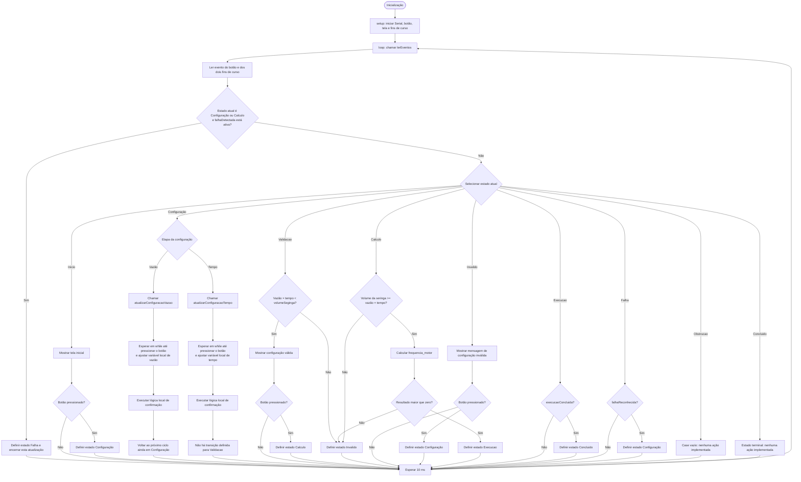

# Sir Inga

Firmware acadêmico para uma bomba de infusão automatizada. Este README descreve o fluxo que está implementado atualmente em `src/main/main.cpp`; estados e eventos ainda incompletos aparecem sinalizados no diagrama.

## Fluxograma do programa atual

## Observações sobre o fluxo

- `lerEventos()` lê o botão e atualiza os dois fins de curso. Os eventos dos fins de curso são armazenados, mas ainda não provocam transição de estado.
- As funções de configuração usam `while`, então bloqueiam a atualização normal da máquina enquanto esperam pelo botão.
- No estado `Configuracao`, as variáveis locais de confirmação são reiniciadas a cada ciclo. A etapa de tempo ainda não leva o programa a `Validacao`.
- `falhaDetectada`, `falhaReconhecida` e `execucaoConcluida` ainda não são preenchidos pela leitura de eventos. Por isso, os caminhos `Falha` e `Concluido` não são acionados pelos sensores atualmente.
- `Estado::Obstrucao` existe, mas seu `case` está vazio.
- O estado `Execucao` ainda não chama o motor; ele apenas verifica `execucaoConcluida`.
- O cálculo chamado `calcular_intervalo_passo()` retorna atualmente uma frequência aproximada em passos por segundo, embora o nome sugira um intervalo entre passos.

## Como atualizar o diagrama

O diagrama está escrito em Mermaid. Ao mudar uma transição ou adicionar uma ação a um estado em `main.cpp`, atualize o fluxo correspondente aqui também. O Mermaid pode ser visualizado em editores que oferecem suporte a diagramas Mermaid, incluindo a visualização do README no GitHub.
